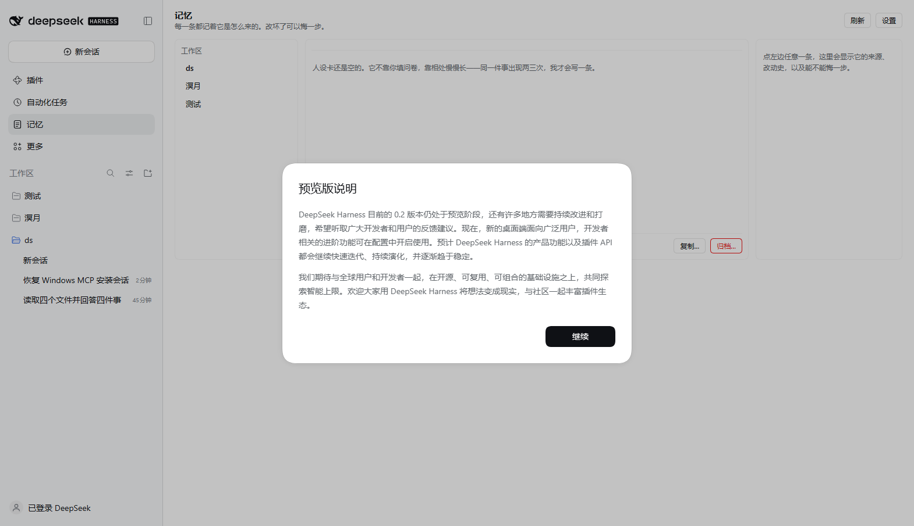

# dsh-persona-panel

给 DeepSeek Harness 的**记忆面板**：人设卡、用户画像、事件各存一份，**按工作区分开**，每条都能看来历、能撤回。

它不让模型「扮演一个角色」，而是让它**在某个工作区里，慢慢长成一个有脾气的东西**——并且这件事你随时能看、能改、能停。



---

## 三条原则

1. **不向你索取人设。** 没有「请先设定你的角色」表单。特征是相处里长出来的，同一件事出现两次以上才会落一条。
2. **不按会话记，按工作区记。** 工作区默认是空的，也不问你「从哪来」。想让记忆跟过去，手动「复制…」：复制一份带走，或共生（两个工作区共用一份，可随时切断）。共生时**名字、称呼、三个开关、词库、事件上限**跟着那份数据走，两边改一处两边都变；切断后各自独立。
3. **你能看见每一条是怎么来的。** 每条记忆都带原话与改动史；删人设是分阶段的（先记一次不满、再降、才删），面板可以替你直接删。

---

## 它长在哪

| 位置 | 是什么 |
|---|---|
| 侧栏「记忆」 | 全宽主面板：工作区列表 / 三块内容 / 右侧来历抽屉 |
| 设置 → 记忆 | 同一个面板，在设置里也开一份 |
| 工作区的会话菜单 | 会话「⋯」菜单里多一项，点了直接跳到这个工作区的记忆 |
| 会话内浮卡 | 全手动挡有待你决定的条目时，右下角浮出来问一句 |

工作区列表那一行自己的「⋯」里**没有**插件插槽（那是内置包硬编码的），所以入口挂在会话菜单上。

---

## 四个抽屉 + 一个称呼

| 抽屉 | 装什么 | 谁写 |
|---|---|---|
| **人设卡**（self） | 大类（带强度）+ 人格补充（可标「硬」） | 模型从对话里归纳，或你手动加 |
| **画像**（user） | 对你的印象，一条一句 | 模型，多聊几次才总结 |
| **事件**（event） | 承诺、约定、值得记住的事，以及**工程事件**（项目推进、定下的方案、做完并验收的一段工作） | 模型，到期它自己提一句 |
| **日记**（diary） | 它自己写的一句话，第一人称 | 模型，**写完不能改、不能删** |
| **称呼**（setting） | 我叫什么、我怎么称呼你 | 模型，你说出口的当下就改 |

**日记是它自己的那一列。** 不是摘要、不是日志接口，是「今天这件事我记下了」这种自述，每条带日期。面板里是只读的——没有改、没有删，宿主侧也拒绝任何 `updateEntry` / `delEntry` / `persona_forget` 碰它。它跟着工作区走：共生时共享，复制和归档也一起带。**不设条数上限**；每场会话的第一轮读它——先读最近 21 天，还有余量就往前翻，放不下的在末尾说明并留给 `persona_recall`（那个从最早一条开始列）。

「硬」标记的人格补充会排在最前面注入——适合放「绝不替我做主」这类不能改写的规则。

工程事件（`eventKind=work`）记的是过程：项目推进到哪、定了什么方案、哪段工作验收了。**坑和教训不写在这里**——踩过的坑、发现的漏洞、以后要避免的做法，提示词会要求模型写进项目的 `AGENTS.md` 或仓库文档。这里可以替你想起「上周定了什么」，但不该成为工程经验唯一的存放处。

**事件有容量，默认 20 条，可改，0 = 不限。** 满了之后模型写不进新的，那条会挂成一张卡问你：扩容量，还是就到这里。它觉得某件对你特别重要时会标 `★`——星标不占容量、查的时候排最前；你在事件详情里也能手动标。

**什么常驻、什么按需：** 人设和画像每一轮都在；事件和日记不常驻——它们躺在库里，模型觉得「忘了什么」时用 `persona_recall` 查，那个工具给全量、不截断。想不起日子、只记得「跟猫有关」的时候，带 `query` 按词找：空格分开的每个词都要命中，日期片段（`10-25`、`2026-10`）也算词。常驻段只额外带一样东西：**三天内要到日子的事**（约定、生日、交付日），到点提一句。这样记忆可以一直长，每一轮的上下文不会跟着长。

**「回忆并写入」不是让宿主替它总结聊天。** 面板不在磁盘上导出任何转写，而是直接给这个工作区的会话发一条指令：停下别的事，按人设、硬规则、画像、事件四类各写几条——先 `persona_recall` 看已经有什么，别重复；写第一人称的具体的话，不要摘要；手上没有这段对话就直说，不许编。会话开着就当场执行；没开着就叫不醒，面板会明说，不会静默排着。

---

## 四挡记录

| 挡位 | 模型能不能自己写 |
|---|---|
| 全手动（默认） | 不能。写之前先进「待你决定」，你在会话里点「留着」才落 |
| 半自动 | 能，但改人设要你点头 |
| 自动 | 能，直接写 |
| 只读 | 谁都不写，只注入 |

「启用」和「记录」是两个开关：关掉「启用」= 不注入也不显示；关掉「记录」= 不新增，但已有的还在。**只关记录 ≠ 忘。**

改名与称呼（setting）不受全手动拦——那是状态，不是记忆。

---

## 别人也在（多用户画像，默认关）

给把 DSH 接进 QQ / 群聊的人准备：主画像之外再开一列「别人」，一个人一个分支，可以按名字或别名搜到。

| 开关 | 关着 | 开着 |
|---|---|---|
| 启用 | 他们的画像不注入、面板里折叠成一行 | 提示段多出一节「同一屋檐下的其他人」，每人最多三句印象、三件事 |
| 记录 | 不新增关于别人的印象与事件 | 模型可以用 `who` 把印象/事件记到具体某个人名下 |

- 默认**两个都关**。不打开时，群友说过的话不落任何盘。
- 事件会带 `who` 字段，写进那个人的分支，模型提到时会带上名字（「小缘约的下周三」）。
- 关掉「启用」只是折叠，已有记录还在；再打开就回来。**只关 ≠ 忘**，跟主画像一样。
- 名字可以改，旧名自动进别名，搜旧名还找得到。

---

## 四个工具

| 工具 | 干什么 |
|---|---|
| `persona_recall` | 读全部记忆（人设、画像、事件、日记，不截断）；模型觉得忘了什么时用 |
| `persona_remember` | 记一条：`self` 脾气、`user` 印象、`event` 约定、`diary` 日记、`setting` 称呼；带 `who` 就记到那个群友名下 |
| `persona_forget` | 改一条或删一条（人设是分阶段删） |
| `persona_ask_keep` | 拿不准就先问你，写进「待你决定」 |

模型侧的提示不要求它「汇报记忆」，只要求它**带着底色说话**：不许提「人设卡/记忆/面板」，不许念清单，不许说「我记得你说过」。

---

## 存储

```
~/.dsh/persona-panel/
├── db.json        所有工作区、条目、设置（原子写，坏了会隔离成 db.json.broken-<时间>）
├── audit.log      谁在什么时候改了哪条（超 2 MB 轮转）
└── imports/       人设卡原文（贴一整段或从文件读），等模型自己拆
```

纯本地，不联网。卸载插件不会删这些文件——留着，装上还能接着用。

---

## 装

| 方式 | 怎么做 | 升级 |
|---|---|---|
| 源码（现在就能用） | `dsh plugin add https://github.com/mihomooo/dsh-persona-panel` | 卸载后重装 |
| Release 压缩包 | 从 [Releases](https://github.com/mihomooo/dsh-persona-panel/releases) 下 `.tgz` 直接装 | 卸载后重装 |
| 插件市场 | 条目已备好（`data/plugins/mihomooo__dsh-persona-panel.yml`），**还没提交**——仓库要满 1 天才能提 PR | 市场里重装 |
| npm | **尚未发布**（账号在解冻中），现在别用这条 | — |

零依赖，没有构建脚本，装上去就是一个目录，不需要编译。

发布到 npm 只影响市场卡片上显示的下载量，**不改变市场从 GitHub 安装**这一点。想跳过源码安装那一步，也可以从 [Releases](https://github.com/mihomooo/dsh-persona-panel/releases) 下载 `.tgz` 直接装。

**升级不丢记忆**：数据在 `~/.dsh/persona-panel/`，卸载只撤程序。

要求 Harness 0.2.x（用到 `webServer.register`、`slots.inject`、`systemPrompt.section`）。

---

## 归档与找回

「归档…」只是把这个人设/画像/事件从工作区里收走，**不会销毁**。收走之后：

- 面板顶部会留一条横幅：「这个工作区的 N 条记忆在 某时 被归档了」，旁边就是**找回**按钮，点一下并回来；
- 也可以走 **设置 → 无主记忆 → 找回…**，那里列着所有归档和删掉的工作区留下的记忆。

找回是**合并**：归档之后新写的条目留着，同 id 只留一份。「永久删除」要点两次——第一次只是把按钮变成「真要永久删？」，4 秒不动就恢复原样。

真正不可逆的只有「永久删除」。

---

## 已知边界

- 「回忆并写入」叫的是**这个工作区正在开着的会话**：它是让模型拿自己上下文里的对话去回忆，所以准不准取决于那段对话本身；换个工作区、或会话刚重开还没有内容，它会明说「我手上没有这段记忆」而不编。跨会话的历史，它看不到。
- 人设卡原文会留在 `~/.dsh/persona-panel/imports/` 下，目前没有自动清理。
- 全手动挡的待决卡片需要你点一下；不点就一直等着，不会自动通过。
- 工作区列表按「最近真的在那里说过话」排；打开面板、点一下别的行都不会让顺序变化。

---

MIT
